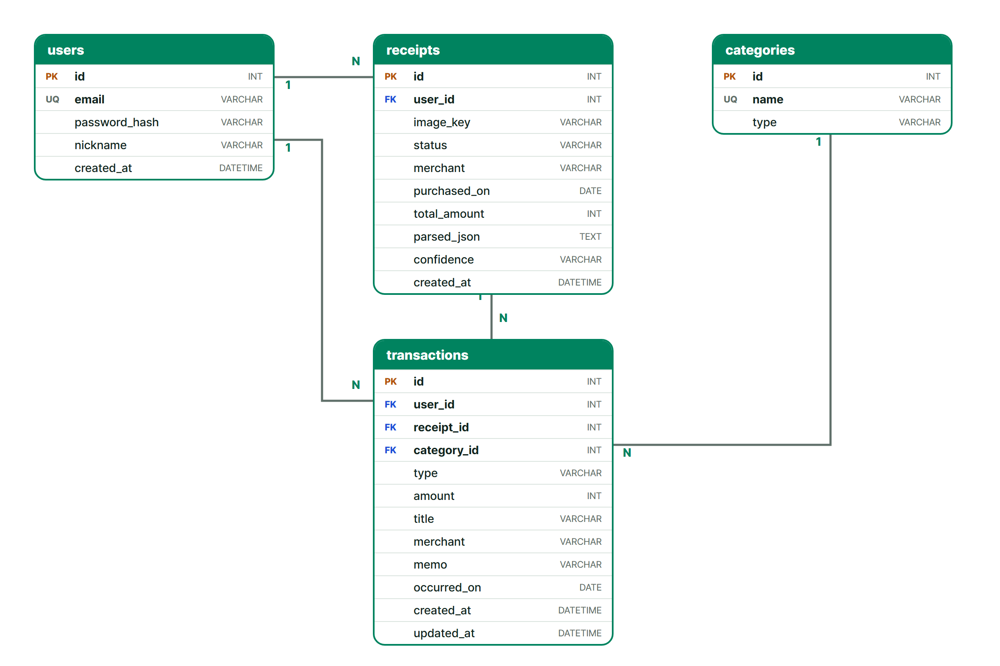

# 08. DB 논리 설계 (관계형) 와 MongoDB 대응

이 문서는 **설계 산출물**이다. 학생은 관계형(SQL) 방식으로 테이블을 설계하고 ERD를 그린다.
**실제 구현은 MongoDB** 이다 (04 문서). SQL 서버(MySQL, PostgreSQL 등)는 설치하지 않고, 아래 SQL은 실행하지 않는다.

> 코드 모드 규칙: 이 문서의 SQL로 데이터베이스나 테이블을 만들지 않는다. 구현은 04 문서 기준이다.
> 두 문서가 어긋나면 04 문서(MongoDB)가 구현 기준이고, 이 문서는 설계 기준이다. 어긋나는 부분은 아래 2절 대응표에 모두 적혀 있어야 한다.

## 1. ERD



| 관계 | 의미 |
|---|---|
| users 1 : N receipts | 한 사용자가 영수증을 여러 장 올린다 |
| users 1 : N transactions | 한 사용자가 내역을 여러 건 가진다 |
| receipts 1 : N transactions | 영수증 한 장의 품목이 내역 여러 건이 된다 (직접 입력한 내역은 `receipt_id` 가 비어 있다) |
| categories 1 : N transactions | 내역은 카테고리 하나에 속한다 |

영수증 품목을 따로 저장하는 테이블은 두지 않는다. 사용자가 확인·저장한 품목은 곧바로 `transactions` 의 행이 된다.
분석이 끝난 직후의 품목 목록은 `receipts.parsed_json` (원문)에서 만든다.

## 2. 테이블 정의 (SQL)

```sql
CREATE TABLE users (
  id            INT          NOT NULL AUTO_INCREMENT PRIMARY KEY,
  email         VARCHAR(254) NOT NULL UNIQUE,
  password_hash VARCHAR(100) NOT NULL,
  nickname      VARCHAR(12)  NOT NULL,
  created_at    DATETIME     NOT NULL
);

CREATE TABLE categories (
  id   INT         NOT NULL AUTO_INCREMENT PRIMARY KEY,
  name VARCHAR(10) NOT NULL UNIQUE,
  type VARCHAR(7)  NOT NULL CHECK (type IN ('expense', 'income'))
);

CREATE TABLE receipts (
  id           INT          NOT NULL AUTO_INCREMENT PRIMARY KEY,
  user_id      INT          NOT NULL,
  image_key    VARCHAR(200) NOT NULL,
  status       VARCHAR(9)   NOT NULL CHECK (status IN ('analyzed', 'confirmed')),
  merchant     VARCHAR(50)  NULL,
  purchased_on DATE         NULL,
  total_amount INT          NULL,
  parsed_json  TEXT         NOT NULL,
  confidence   VARCHAR(6)   NOT NULL CHECK (confidence IN ('high', 'medium', 'low')),
  created_at   DATETIME     NOT NULL,
  FOREIGN KEY (user_id) REFERENCES users(id) ON DELETE CASCADE
);

CREATE TABLE transactions (
  id          INT          NOT NULL AUTO_INCREMENT PRIMARY KEY,
  user_id     INT          NOT NULL,
  receipt_id  INT          NULL,
  category_id INT          NOT NULL,
  type        VARCHAR(7)   NOT NULL CHECK (type IN ('expense', 'income')),
  amount      INT          NOT NULL,            -- 영수증 할인 품목만 음수
  title       VARCHAR(40)  NOT NULL,
  merchant    VARCHAR(50)  NULL,
  memo        VARCHAR(100) NOT NULL DEFAULT '',
  occurred_on DATE         NOT NULL,
  created_at  DATETIME     NOT NULL,
  updated_at  DATETIME     NOT NULL,
  FOREIGN KEY (user_id)     REFERENCES users(id)      ON DELETE CASCADE,
  FOREIGN KEY (receipt_id)  REFERENCES receipts(id)   ON DELETE SET NULL,
  FOREIGN KEY (category_id) REFERENCES categories(id)
);

CREATE INDEX idx_tx_user_date ON transactions (user_id, occurred_on);
CREATE INDEX idx_tx_user_type_category ON transactions (user_id, type, category_id, occurred_on);
```

`categories` 에 들어갈 값은 04 문서 4절의 목록 12개(지출 9, 수입 3)이다.
로그인 상태는 JWT 쿠키에 담기므로(서버에 저장하지 않음) 세션 테이블은 두지 않는다.

## 3. 대응표 (관계형 설계 → MongoDB 구현)

| 관계형 설계 | MongoDB 구현 |
|---|---|
| 테이블 `users`, `receipts`, `transactions` | 같은 이름의 컬렉션 3개 |
| 테이블 `categories` | **컬렉션 없음.** 서버 상수 목록(04 문서 4절). `transactions.category` 에 이름 문자열을 저장 |
| `id INT AUTO_INCREMENT` | 문자열 ID 필드 `uid`, `transaction_id`, `receipt_id` (서버가 만드는 `uuid4().hex`). `_id` 는 쓰지 않는다 |
| 외래키 `user_id`, `receipt_id` | 문자열 필드 `uid`, `receipt_id`. **DB가 무결성을 검사하지 않으므로** 서버 코드가 소유자 확인을 한다 |
| 외래키 `category_id` | `category` 문자열. 서버가 상수 목록에 있는지 검증한다 |
| `DATE` | `"YYYY-MM-DD"` 문자열 |
| `DATETIME` | UTC `datetime` |
| `UNIQUE` | unique 인덱스 (`users.email`, 각 컬렉션의 ID 필드) |
| `ON DELETE CASCADE` | 없음. 회원 탈퇴 때 서버가 `transactions` → `receipts`(이미지 파일 포함) → `users` 순서로 삭제한다 (04 문서 6절) |
| `ON DELETE SET NULL` | 해당 없음 (영수증은 탈퇴 때만 삭제된다) |
| `JOIN` | 없음. 통계는 `transactions` 한 컬렉션만 집계한다 (`category` 문자열이 들어 있으므로) |
| 인덱스 2개 | 04 문서 각 컬렉션 절의 인덱스 |

수업 포인트: 관계형에서는 카테고리를 테이블로 분리하고 JOIN으로 이름을 가져온다. 이 프로젝트의 MongoDB는 이름을 문서에 직접 넣어 JOIN을 없앴다.
대신 카테고리 이름을 바꾸면 기존 문서를 모두 고쳐야 한다. 이 차이가 "SQL과 NoSQL, 왜 MongoDB인가"의 실제 사례이다.

## 4. 같은 질문, 두 가지 쿼리

월별 요약:

```sql
SELECT type, SUM(amount) AS total
FROM transactions
WHERE user_id = ? AND occurred_on >= ? AND occurred_on < ?
GROUP BY type;
```
```
db.transactions.aggregate([
  { $match: { uid, occurred_on: { $gte: start, $lt: next } } },
  { $group: { _id: "$type", total: { $sum: "$amount" } } }
])
```

카테고리 통계(지출):

```sql
SELECT c.name, SUM(t.amount) AS amount, COUNT(*) AS count
FROM transactions t
JOIN categories c ON c.id = t.category_id
WHERE t.user_id = ? AND t.type = 'expense'
  AND t.occurred_on >= ? AND t.occurred_on < ?
GROUP BY c.name
HAVING SUM(t.amount) > 0
ORDER BY amount DESC;
```
```
db.transactions.aggregate([
  { $match: { uid, type: "expense", occurred_on: { $gte: start, $lt: next } } },
  { $group: { _id: "$category", amount: { $sum: "$amount" }, count: { $sum: 1 } } },
  { $match: { amount: { $gt: 0 } } },
  { $sort: { amount: -1 } }
])
```

## 5. 학생 과제 (설계 단계)

1. ERD를 직접 그린다 (도구 자유). 1절 그림은 정답이 아니라 예시이다.
2. 요구 기능 목록(02 문서)에서 테이블과 컬럼을 뽑아 본다.
3. 카테고리를 테이블로 분리한 이유와 문자열로 두었을 때의 장단점을 한 문단으로 쓴다.
